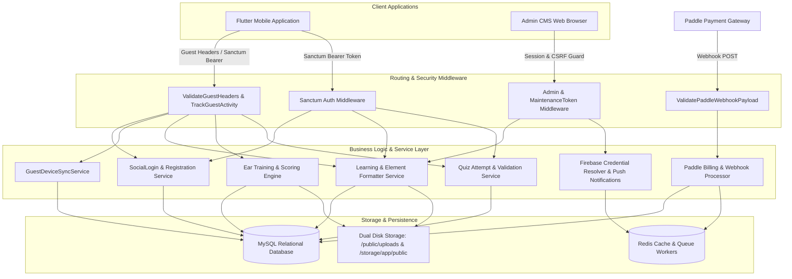
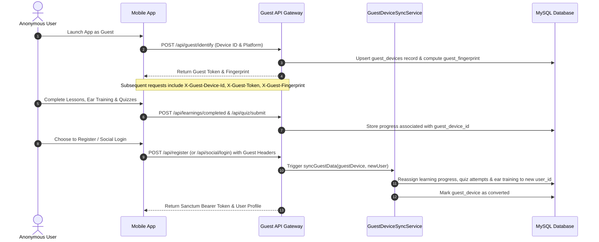
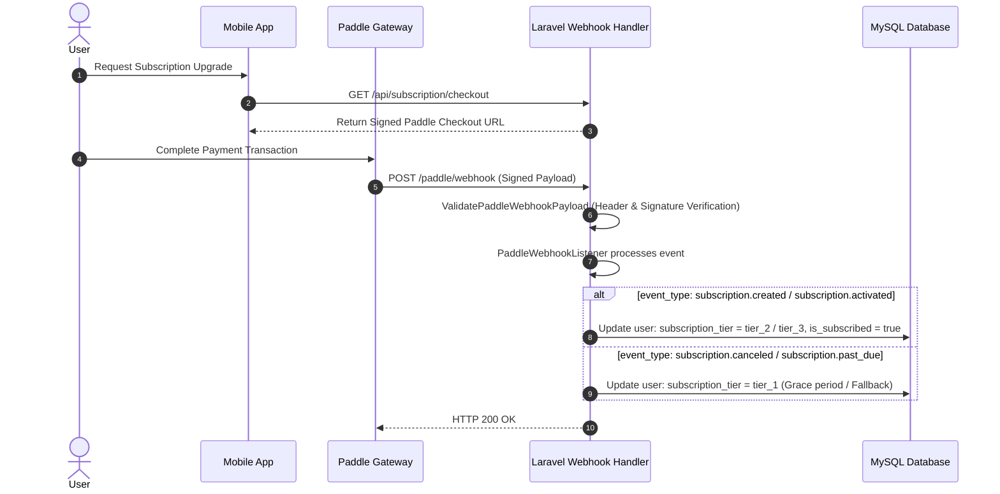

# Numonix: Modern Music Theory & Functional Ear Training Platform

> An enterprise-grade, high-performance RESTful API and Admin Management CMS powering modern mobile music learning applications, featuring functional ear training, interactive music theory curricula, automated subscription lifecycle management, and seamless guest-to-user data synchronization.

---

## 2. Used Technologies

### Backend & Core Framework
- **PHP**: `^8.2` (Target runtime platform: `8.4.0`)
- **Laravel Framework**: `^12.0`
- **Laravel Sanctum**: `^4.0` (Stateless API token authentication & SPA guard)
- **Laravel Socialite**: `^5.24` (OAuth 2.0 social authentication with custom Apple provider)
- **Ichtrojan Laravel OTP**: `^2.0` (Cryptographic email verification and password reset one-time tokens)
- **Spatie Laravel Activitylog**: `^5.0` (Structured administrative audit trail)
- **Yajra DataTables**: `12.*` (Server-side tabular data processing for admin CMS)

### Database & Storage
- **MySQL**: `8.0+` (Relational data store with foreign key integrity, transactions, and indexing)
- **Redis / Database Queue**: Asynchronous job queue processing and cache accelerator
- **Flysystem / Public Storage**: Dual-disk mirrored media storage architecture (`/public/uploads` & `/storage/app/public`)

### Authentication & Third-Party Integrations
- **Paddle Billing (Laravel Cashier Paddle)**: `^2.8` (Merchant-of-record subscription billing, webhook verification, and founder trials)
- **Firebase Admin SDK (kreait/laravel-firebase)**: `^6.2` (Dynamic credential resolution & FCM push notifications)
- **Firebase PHP JWT**: `^7.0` (Cryptographic verification of Google and Apple identity tokens)
- **GuzzleHTTP**: `^7.10` (HTTP client for external verification and API integrations)

### Frontend & Administrative CMS
- **Blade Template Engine**: Modular server-rendered administration UI
- **Alpine.js**: `^3.4.2` (Lightweight reactive frontend components)
- **Tailwind CSS**: `^3.1.0` / `@tailwindcss/vite ^4.0.0` (Utility-first responsive styles)
- **Vite**: `^6.2.4` (Modern asset bundler)

### DevOps, Testing & Quality Assurance
- **Pest PHP**: `^3.8` & **Pest Plugin Laravel**: `^3.2` (Modern testing framework)
- **PHPStan / Larastan**: `^2.2` / `^3.10` (Static code analysis and architectural verification)
- **Laravel Pint**: `^1.13` (Code style enforcement)
- **Docker & Docker Compose**: Containerized multi-stage local development and deployment
- **GitHub Actions**: Automated continuous deployment pipeline with strict SSH host verification

---

## 3. Project Overview

### The Problem
Traditional music theory and ear training applications frequently suffer from high initial barrier to entry, rigid subscription walls that alienate exploratory users, disjointed educational content delivery, and loss of learning history when users transition between devices or switch from guest browsing to registered accounts. Furthermore, administering rich multimedia lesson pages (combining audio snippets, text explanations, harmonic visuals, and tiered access levels) typically requires complex content management systems.

### Target Users
1. **Music Students & Independent Learners**: Users seeking systematic, bite-sized functional ear training, interval recognition, and progressive music theory lessons.
2. **Founder & Early Adopter Cohorts**: Premium pilot users participating in structured 30-day trial programmes with automated conversion funnels.
3. **Platform Administrators & Content Curators**: Educators and administrators managing courses, quizzes, media audio assets, and reviewing user engagement analytics.

### Business Value
- **Frictionless Onboarding**: Anonymous guest sessions track device fingerprints and store lesson checkpoints locally and server-side, eliminating friction before sign-up.
- **Conversion-Driven Retention**: Automatic guest-to-user data synchronization transfers all accumulated quiz scores, completed lessons, and checklists immediately upon registration or social login.
- **Automated Revenue Funnel**: Paddle integration powers subscription tiers (Free Foundation, Tier 1, and Tier 2) alongside an automated 30-day Founder Programme trial with scheduled email notifications, review capture, and special conversion pricing.
- **Unified Media Resilience**: Dual-layer media serving guarantees that uploaded audio and visual assets resolve consistently across containerized environments and shared hosting without symlink degradation.

### Technically Interesting Highlights
- **Cryptographic Apple & Google Token Verification**: Custom Socialite provider verifying Apple ID identity tokens (handling RS256 JWK public keys, audience validation, and nonce verification) alongside Google OAuth token pipelines.
- **Resilient Firebase Credential Resolver**: Dynamic resolution chain that safely loads service account credentials from dashboard uploads, system environment variables, raw JSON, or base64-encoded strings with automatic test clean-up.
- **Race-Condition-Resistant Webhook Processing**: Custom middleware (`ValidatePaddleWebhookPayload`) and listener (`PaddleWebhookListener`) resolving Cashier route conflicts, enforcing raw payload validation, and guaranteeing idempotent subscription renewals and cancellations.
- **Stateless Guest Device Fingerprinting**: Algorithmic SHA-256 fingerprint generation derived from device identifiers, salt keys, and client headers to support stateful learning progress for unauthenticated visitors.

---

## 4. System Architecture & Workflow

### 4.1 High-Level Architecture



### 4.2 Guest Device Identification & Conversion Flow



### 4.3 Subscription & Webhook Processing Flow



---

## 5. Key Functional Modules & Flows

### 5.1 Authentication, Identity & Social Sign-In
- **Traditional Auth**: Registration, login, and profile management secured by Laravel Sanctum.
- **OTP Verification Pipeline**: Password reset and email confirmation enforced via 6-digit cryptographic OTPs expiring within configured TTLs.
- **Google & Apple Social Login**: Decodes and verifies identity tokens directly against Google OAuth and Apple JWK public endpoints. Automatically creates user profiles and binds guest history.
- **Roles**: `User` (subdivided into `tier_1`, `tier_2`, `tier_3`, and `Founder`), and `Admin`.

### 5.2 Guest Device Tracking & Seamless Migration
- **Header Enforcement**: All guest-accessible endpoints require `X-Guest-Device-Id`, `X-Guest-Token`, and `X-Guest-Fingerprint`.
- **Activity Auditing**: `TrackGuestActivity` middleware maintains real-time touchpoint metrics for anonymous visitors.
- **Automated Data Sync**: `GuestDeviceSyncService` atomically re-links all guest records (`learning_user_progress`, `quiz_attempts`, `ear_training_quiz_attempts`, `learning_checklist_progress`) upon user registration or sign-in.

### 5.3 Curriculum Management & Interactive Lessons
- **Course Hierarchy**: Organized into Core Theory, Lessons, Advanced Insights, Case Studies, and FNH Architecture.
- **Modular Learning Page Elements**: Each lesson page supports dynamic block sequences:
  - Paragraphs with rich text
  - Section headers
  - Bulleted key points
  - Images with responsive fallbacks
  - Audio player blocks for musical examples
  - Interactive sentence visual builders
- **Access Control Matrix**: Content visibility governed by `ContentAccessConfig` ensuring fine-grained gating based on user subscription tiers.

### 5.4 Functional Ear Training & Audio Engine
- **Curriculum Progression**: Multi-stage, multi-level music theory and listening modules.
- **Stateless & Stateful Scoring**: Allows guest practice while providing deep persistence for registered users.
- **Explanation Templates**: Dynamic pedagogical feedback explaining tonic root relationships, intervals, and harmonic contexts.

### 5.5 Assessment & Quiz System
- **Context-Bound Quizzes**: Quizzes associated directly with lessons, topics, or standalone challenges.
- **Interactive Validation**: Single-question immediate validation (`/api/quiz/check-answer`) alongside full attempt submission and scoring (`/api/quiz/submit/{learning_id}`).
- **Review & Retries**: Full attempt detail inspection, incorrect answer breakdowns, and configurable retry mechanics.

### 5.6 Paddle Monetization & Founder Programme
- **Cashier Paddle Integration**: Handles checkout session generation, recurring billing, invoices, and webhooks.
- **Founder Rolling Programme**:
  - VIP 30-day full-access trial for early subscribers.
  - Automated midnight UTC scheduler (`founders:process-trials`) triggering Day 25 review reminders, Day 30 lifetime conversion offers, and Day 31 access revocations.
  - Administrative dashboard tracking conversion analytics and CSV exports.

### 5.7 Cloud Push Notifications & Media Management
- **Firebase Cloud Messaging**: Device token registry supporting multi-device delivery and targeted custom notifications.
- **Dual Storage Engine**: `UploadStorageHelper` dual-writes media to `storage/app/public` and `public/uploads`, eliminating shared-hosting symlink failures and ensuring zero broken assets.

---

## 6. Project Structure & API Reference

### 6.1 Annotated Directory Structure

```plaintext
app/
├── Channels/                 # Notification delivery channels
├── Console/Commands/         # Scheduled automation (ProcessFounderTrials, DeployCheck)
├── Enums/                    # Application enums (SubscriptionTier, UserRole)
├── Events/                   # Domain events (UserRegistered, SubscriptionUpdated)
├── Exceptions/               # Domain exception handlers (GuestDeviceSyncException)
├── Helpers/                  # Helper utilities (UploadStorageHelper, ApiResponseHelper)
├── Http/
│   ├── Controllers/
│   │   ├── API/              # RESTful API controllers (Auth, Learning, EarTraining, Quiz, Paddle)
│   │   └── Web/              # Admin CMS controllers (Dashboard, Users, CMS, Settings)
│   └── Middleware/           # Gateways (AdminMiddleware, ValidateGuestHeaders, ValidatePaddleWebhookPayload)
├── Jobs/                     # Queued tasks (SendBulkEmailJob, ProcessExportJob)
├── Listeners/                # Event listeners (PaddleWebhookListener, SendOtpListener)
├── Mail/                     # Mailable templates (FounderWelcomeEmail, DataExportMail)
├── Models/                   # Eloquent models (User, Learning, EarTrainingLevel, Quiz, GuestDevice)
├── Notifications/            # FCM and database notification classes
├── Providers/                # Service providers (AppServiceProvider, RepositoryServiceProvider)
├── Repositories/             # Repository pattern implementations & interfaces
├── Services/                 # Domain business services (LearningService, SocialLoginService, FCMService)
└── Traits/                   # Reusable model traits (FileManager, ImagePathTrait)
config/                       # Application configuration files (cashier, firebase, services)
database/
├── factories/                # Model factories for unit testing
├── migrations/               # Structured schema migrations
└── seeders/                  # Database seeders (LearningSeeder, EarTrainingSeeder, FaqSeeder)
public/
├── uploads/                  # Mirrored public media uploads directory
└── build/                    # Compiled frontend assets
resources/
└── views/                    # Blade admin layouts, components, and email templates
routes/
├── api.php                   # Core REST API route definitions (84 endpoints)
├── backend.php               # Administrative CMS route group
├── console.php               # Scheduled cron job schedules
├── settings.php              # System and administrative configuration routes
└── web.php                   # Web entry points, storage fallback routes, Paddle webhooks
tests/
├── Feature/                  # Feature test suites (Auth, Learning, EarTraining, Quiz, Paddle)
└── Unit/                     # Unit test suites (Services, Repositories, CredentialResolvers)
```

---

### 6.2 Full REST API Reference

#### 1. Guest Device Identification & Progress
| Method | Endpoint | Auth | Description | Key Request / Response Fields |
| :--- | :--- | :--- | :--- | :--- |
| `POST` | `/api/guest/identify` | None (Throttle: 5/min) | Register or update guest device identity | Req: `device_id`, `platform`, `device_name`<br>Res: `guest_token`, `guest_fingerprint` |
| `GET` | `/api/guest/device` | Guest Headers | Retrieve current guest device metadata | Req: Guest Headers<br>Res: `device_id`, `total_actions`, `is_converted` |
| `GET` | `/api/user/progress` | Guest / Sanctum | Retrieve unified progress dashboard across all curricula | Req: Guest Headers or Bearer Token<br>Res: `{courses_completed, quiz_stats, ear_training_score}` |
| `POST` | `/api/learnings/checklist/update` | Guest / Sanctum | Update interactive lesson checklist state | Req: `learning_id`, `item_id`, `is_checked`<br>Res: `{status: 200, progress}` |

#### 2. Authentication, Account & Profile Management
| Method | Endpoint | Auth | Description | Key Request / Response Fields |
| :--- | :--- | :--- | :--- | :--- |
| `POST` | `/api/register` | Guest Sanctum (Throttle: 5/min) | Create new user account & migrate guest records | Req: `name`, `email`, `password`, `password_confirmation`<br>Res: `{token, user}` |
| `POST` | `/api/login` | Guest Sanctum (Throttle: 6/min) | User login via credentials | Req: `email`, `password`<br>Res: `{token, user}` |
| `POST` | `/api/email/verify` | Guest Sanctum | Verify email address using 6-digit OTP | Req: `email`, `otp`<br>Res: `{status: 200, message}` |
| `POST` | `/api/email/verify/resend` | Guest Sanctum (Throttle: 2/min) | Resend email verification OTP | Req: `email`<br>Res: `{status: 200, message}` |
| `POST` | `/api/password/forgot` | Guest Sanctum (Throttle: 3/min) | Dispatch password reset OTP to email | Req: `email`<br>Res: `{status: 200, message}` |
| `POST` | `/api/password/forgot/verify`| Guest Sanctum | Validate password reset OTP | Req: `email`, `otp`<br>Res: `{status: 200, reset_token}` |
| `POST` | `/api/password/reset` | Guest Sanctum (Throttle: 5/min) | Reset account password using token | Req: `email`, `token`, `password`, `password_confirmation`<br>Res: Confirmation |
| `POST` | `/api/logout` | Sanctum | Invalidate current bearer token | Res: `message: Logged out` |
| `POST` | `/api/logout/all` | Sanctum | Invalidate all active user tokens | Res: `message: All sessions terminated` |
| `GET` | `/api/dashboard` | Sanctum | Authenticated user personal dashboard overview | Res: `{user, recent_activity, subscriptions, stats}` |
| `GET` | `/api/profile` | Sanctum | Retrieve authenticated profile details | Res: `{id, name, email, avatar, role, subscription_tier}` |
| `GET` | `/api/profile/manage-account`| Sanctum | Retrieve account configuration and security status | Res: `{user, sessions, permissions}` |
| `POST` | `/api/profile/details` | Sanctum | Update name, age verification, and avatar image | Req: `name`, `avatar` (file), `is_age_verified`<br>Res: Updated profile |
| `POST` | `/api/profile/change-password`| Sanctum | Update account password | Req: `current_password`, `password`, `password_confirmation` |
| `POST` | `/api/auth/change-password` | Sanctum | Secondary password update endpoint | Req: `old_password`, `password`, `password_confirmation` |
| `POST` | `/api/profile/download-my-data`| Sanctum | Request GDPR user archive export dispatched via email | Res: Trigger background export dispatched via email |
| `POST` | `/api/profile/delete-account` | Sanctum | Permanently purge account and progress data | Req: `password`<br>Res: Confirmation |

#### 3. Social Authentication
| Method | Endpoint | Auth | Description | Key Request / Response Fields |
| :--- | :--- | :--- | :--- | :--- |
| `POST` | `/api/social/login` | None (Throttle: 10/min) | Authenticate using Google OAuth or Apple ID token | Req: `provider` (`google`\|`apple`), `id_token`, `nonce`<br>Res: `{token, user}` |
| `POST` | `/api/social/apple/callback`| None (Throttle: 10/min) | Server-side Apple OAuth callback handler | Req: `code`, `id_token`<br>Res: `{token, user}` |

#### 4. Curriculum & Learning Modules (Guest & User Aware)
| Method | Endpoint | Auth | Description | Key Request / Response Fields |
| :--- | :--- | :--- | :--- | :--- |
| `GET` | `/api/home` | Guest / Sanctum | Aggregated dashboard with active modules & banners | Res: `{banners, modules, progress, recommendations}` |
| `GET` | `/api/learnings` | Guest / Sanctum | List all published learning modules | Res: List of `{id, title, thumbnail, difficulty, total_lessons}` |
| `GET` | `/api/learnings/lessons` | Guest / Sanctum | List lessons filtered by category | Res: List of `{id, title, category, duration}` |
| `GET` | `/api/learnings/core-theory` | Guest / Sanctum | Fetch core music theory lessons | Res: List of theoretical modules |
| `GET` | `/api/learnings/advanced-insights`| Guest / Sanctum | Fetch advanced insights modules | Res: List of advanced analytical modules |
| `GET` | `/api/learnings/case-studies`| Guest / Sanctum | Fetch musical case study modules | Res: List of musical analysis breakdowns |
| `GET` | `/api/learnings/fnh-architecture`| Guest / Sanctum | Fetch Functional Natural Harmony architecture | Res: Complete FNH system overview |
| `GET` | `/api/learnings/show/{id}` | Guest / Sanctum | Retrieve complete lesson with multimedia content blocks | Res: `{id, title, pages: [{elements: [...]}]}` |
| `GET` | `/api/learnings/summary/{id}`| Guest / Sanctum | Retrieve summary overview of a lesson | Res: `{id, summary_text, key_takeaways}` |
| `POST` | `/api/learnings/completed` | Guest / Sanctum | Mark lesson page complete (saved for user) | Req: `learning_id`, `page_id`<br>Res: `{success: true, next_page_id}` |
| `POST` | `/api/learnings/next` | Sanctum | Navigate to next sequential learning module | Req: `current_learning_id`<br>Res: `{next_learning_id}` |
| `POST` | `/api/learnings/previous` | Sanctum | Navigate to previous learning module | Req: `current_learning_id`<br>Res: `{previous_learning_id}` |

#### 5. Functional Ear Training
| Method | Endpoint | Auth | Description | Key Request / Response Fields |
| :--- | :--- | :--- | :--- | :--- |
| `GET` | `/api/ear-training/stages` | Guest / Sanctum | List all ear training curriculum stages | Res: List of `{id, title, description, total_levels}` |
| `GET` | `/api/ear-training/stages/{stageId}/levels`| Guest / Sanctum | Retrieve progressive levels within a stage | Res: List of `{id, level_number, audio_prompt, questions}` |
| `POST` | `/api/ear-training/submit/{levelId}` | Guest / Sanctum | Submit ear training answer attempt | Req: `answers: [{question_id, selected_option}]`<br>Res: `{score, passed, explanation}` |
| `GET` | `/api/ear-training/explanation-templates`| Guest / Sanctum | Retrieve theoretical explanation templates | Res: List of explanation mapping records |
| `GET` | `/api/ear-training/levels/quizzes/{id}`| Guest / Sanctum | Backward-compatibility alias for level questions | Res: `{stage_id, levels}` |
| `GET/POST`| `/api/functional-ear-training/submit`| Guest / Sanctum | Backward-compatibility alias for submission | Req: `answers`<br>Res: Scoring result |

#### 6. Assessment & Quiz Engine
| Method | Endpoint | Auth | Description | Key Request / Response Fields |
| :--- | :--- | :--- | :--- | :--- |
| `GET` | `/api/quiz/by-learning/{learning_id}`| Guest / Sanctum | Retrieve quiz associated with learning module | Res: `{quiz_id, title, questions: [...]}` |
| `GET` | `/api/quiz/by-lesson/{learning_id}`| Guest / Sanctum | Alias for lesson quiz retrieval | Res: `{quiz_id, title, questions}` |
| `POST` | `/api/quiz/check-answer` | Guest / Sanctum | Stateless single-question immediate evaluation | Req: `question_id`, `selected_option`<br>Res: `{is_correct, explanation}` |
| `POST` | `/api/quiz/submit/{learning_id}`| Guest / Sanctum | Complete full quiz attempt and compute score | Req: `answers: [{question_id, selected_option}]`<br>Res: `{attempt_id, score, percentage, passed}` |
| `GET` | `/api/quiz/review/{attempt_id}`| Guest / Sanctum | Review detailed breakdown of a quiz attempt | Res: Detailed attempt questions with user selection |
| `GET` | `/api/quiz/review-by-learning/{learning_id}`| Guest / Sanctum | Review latest attempt by learning module | Res: `{attempt, questions, results}` |
| `GET` | `/api/quiz/attempt-details/{id}`| Guest / Sanctum | Fetch historical metrics for an attempt | Res: `{attempt_id, score, time_spent, created_at}` |
| `POST` | `/api/quiz/retry/{learning_id}`| Guest / Sanctum | Initialize clean retry session for a quiz | Req: `learning_id`<br>Res: `{quiz_id, questions}` |
| `GET` | `/api/quiz/questions` | Sanctum | Protected comprehensive question directory | Res: Paginated list of questions |

#### 7. Subscriptions, Payments & Webhooks
| Method | Endpoint | Auth | Description | Key Request / Response Fields |
| :--- | :--- | :--- | :--- | :--- |
| `GET` | `/api/subscription/status` | Sanctum | Retrieve active subscription tier and billing state | Res: `{is_subscribed, tier, ends_at, on_grace_period}` |
| `GET/POST`| `/api/subscription/checkout`| Sanctum | Generate signed Paddle checkout URL | Req: `price_id`<br>Res: `{checkout_url}` |
| `POST` | `/paddle/webhook` | Webhook Signature | Validated asynchronous Paddle billing event webhook | Req: Signed Paddle event payload<br>Res: HTTP 200 |

#### 8. Founder Programme
| Method | Endpoint | Auth | Description | Key Request / Response Fields |
| :--- | :--- | :--- | :--- | :--- |
| `GET` | `/api/founder/status` | Sanctum | Fetch Founder Programme trial timeline & status | Res: `{is_founder, trial_days_left, review_completed}` |
| `GET` | `/api/founder/activate/{token}`| None | Single-use founder invitation token activation | Res: Redirect or JSON confirmation |
| `POST` | `/api/founder/review` | Sanctum | Submit 30-day Founder feedback survey | Req: `rating`, `feedback`, `favorite_features`<br>Res: Confirmation |

#### 9. Push Notifications & Preferences
| Method | Endpoint | Auth | Description | Key Request / Response Fields |
| :--- | :--- | :--- | :--- | :--- |
| `GET` | `/api/notifications` | Sanctum | Retrieve paginated user notifications | Res: `{notifications: [...]}` |
| `POST` | `/api/notifications/{id}/mark-as-read`| Sanctum | Mark specific notification as read | Res: `{status: 200}` |
| `POST` | `/api/notifications/mark-all-as-read`| Sanctum | Mark all user notifications as read | Res: `{status: 200}` |
| `POST` | `/api/notifications/send` | Sanctum | Dispatch targeted push notification | Req: `title`, `body`, `user_id`<br>Res: `{status: 200}` |
| `GET` | `/api/notification-settings-show`| Sanctum | Fetch user notification delivery preferences | Res: `{email_alerts, push_alerts, marketing}` |
| `POST` | `/api/notification-settings-update`| Sanctum | Update notification delivery preferences | Req: Preference flags<br>Res: Updated settings |
| `POST` | `/api/firebase-token/add` | Sanctum | Register FCM device push token | Req: `token`, `device_type`<br>Res: Confirmation |
| `POST` | `/api/firebase-token/delete` | Sanctum | Unregister FCM device token | Req: `token`<br>Res: Confirmation |

#### 10. Cookie & Privacy Consent
| Method | Endpoint | Auth | Description | Key Request / Response Fields |
| :--- | :--- | :--- | :--- | :--- |
| `GET` | `/api/cookie-settings-show` | Guest Headers | Fetch cookie preferences (guest or user) | Res: `{analytics_enabled, marketing_enabled}` |
| `POST` | `/api/cookie-settings-update`| Guest Headers | Update cookie consent preferences | Req: `{analytics: bool, marketing: bool}` |

#### 11. User Application Preferences
| Method | Endpoint | Auth | Description | Key Request / Response Fields |
| :--- | :--- | :--- | :--- | :--- |
| `GET` | `/api/preferences` | Sanctum | Fetch user audio and visual preferences | Res: `{audio_playback_speed, dark_mode, notifications}` |
| `POST` | `/api/preferences` | Sanctum | Save user application preferences | Req: Key-value preference settings |

#### 12. Community Reviews
| Method | Endpoint | Auth | Description | Key Request / Response Fields |
| :--- | :--- | :--- | :--- | :--- |
| `GET` | `/api/reviews` | None | Public listing of published user reviews | Res: List of `{id, user_name, rating, comment}` |
| `POST` | `/api/reviews-store` | Sanctum | Submit new user review | Req: `rating`, `comment`<br>Res: Created review |
| `POST` | `/api/reviews-update/{id}` | Sanctum | Update previously submitted user review | Req: `rating`, `comment`<br>Res: Updated review |
| `DELETE`| `/api/reviews-delete/{id}` | Sanctum | Remove user review | Res: Confirmation |

#### 13. Customer Support & Diagnostics
| Method | Endpoint | Auth | Description | Key Request / Response Fields |
| :--- | :--- | :--- | :--- | :--- |
| `POST` | `/api/support/contact` | None | Submit general support contact inquiry | Req: `name`, `email`, `subject`, `message` |
| `POST` | `/api/support/bug-report` | None | Submit application bug report with logs | Req: `title`, `description`, `device_info`, `screenshot` |
| `POST` | `/api/support/feature-suggestion`| None | Submit community feature recommendation | Req: `title`, `description` |

#### 14. System Configuration, App Updates & Static CMS
| Method | Endpoint | Auth | Description | Key Request / Response Fields |
| :--- | :--- | :--- | :--- | :--- |
| `GET` | `/api/system-setting` | None | Fetch global system configurations | Res: `title`, `email`, `copyright_text` |
| `GET` | `/api/app-update/soft` | None | Verify soft update alert status | Res: `status`, `data: boolean`, `message` |
| `GET` | `/api/app-update/force` | None | Verify mandatory update alert status | Res: `status`, `data: boolean`, `message` |
| `GET` | `/api/faq` | None | Retrieve frequently asked questions | Res: List of `{id, question, answer, category}` |
| `GET` | `/api/cms/user-guide` | None | Fetch user guide documentation sections | Res: `{sections: [{title, items: [...]}]}` |
| `GET` | `/api/cms/terms-conditions` | None | Fetch terms and conditions | Res: `{sections: [{title, content}]}` |
| `GET` | `/api/cms/privacy-policy` | None | Fetch privacy policy | Res: `{sections: [{title, content}]}` |
| `GET` | `/api/cms/glossary` | None | Fetch concise music theory terminology | Res: List of `{term, definition}` |
| `GET` | `/api/cms/complete-glossary` | None | Fetch comprehensive glossary reference | Res: Categorized comprehensive terms |
| `GET` | `/api/cms/about-numonix` | None | Platform mission, story, and philosophy | Res: `{sections: [{title, content}]}` |

---

### 6.3 Database Entities & Relationship Summary
- **`users`**: Core identity entity storing roles (`Admin`, `User`), subscription tiers (`tier_1`, `tier_2`, `tier_3`), age verification flags, and Founder Programme timeline dates.
- **`guest_devices`**: Anonymous device registry storing `device_id`, encrypted `guest_token`, and cryptographic `guest_fingerprint`. Has many `guest_activity_logs`.
- **`learnings` & `learning_groups`**: Hierarchical curriculum structure with one-to-many relationships to `learning_pages`, `learning_page_elements` (multimedia/rich-text blocks), and `quizzes`.
- **`learning_user_progress` & `learning_checklist_progress`**: Tracks completed lesson pages, percentage metrics, and interactive checklist items for both guests and authenticated users.
- **`quizzes`, `quiz_questions`, `quiz_attempts`**: Comprehensive assessment tables storing questions, options, correct answers, user submissions, scores, and review histories.
- **`ear_training_stages`, `ear_training_levels`, `ear_training_quizzes`, `ear_training_questions`, `ear_training_quiz_attempts`**: Hierarchical functional ear training music curriculum with audio prompts, intervals, and scoring records.
- **`customers`, `subscriptions`, `subscription_items`, `transactions`**: Cashier Paddle tables mapping external payment entities to local user records.

---

## 7. Environment Configuration (.env)

The following configuration variables must be populated in your local `.env` or production deployment environment:

| Variable | Purpose | Example Placeholder |
| :--- | :--- | :--- |
| `APP_NAME` | The human-readable name of the application | `"Numonix"` |
| `APP_ENV` | Current runtime environment (`local`, `testing`, `production`) | `local` |
| `APP_KEY` | 32-character base64 encryption key for sessions and tokens | `base64:AbCdEfGhIjKlMnOpQrStUvWxYz0123456789=` |
| `APP_DEBUG` | Enables detailed stack traces and debugging tools | `true` (local) / `false` (production) |
| `APP_URL` | Canonical URL of the backend API server | `http://localhost:8000` |
| `FRONTEND_APP_URL` | Canonical URL of the companion web or mobile portal | `http://localhost:3000` |
| `DB_CONNECTION` | Relational database driver | `mysql` |
| `DB_HOST` | Database host address | `127.0.0.1` |
| `DB_PORT` | Database port number | `3306` |
| `DB_DATABASE` | Name of the relational database | `app_database` |
| `DB_USERNAME` | Database connection username | `app_user` |
| `DB_PASSWORD` | Database connection password | `your-db-password` |
| `SESSION_DRIVER` | Session storage driver | `database` |
| `SESSION_ENCRYPT` | Cryptographically encrypt session cookie contents | `false` (local) / `true` (production) |
| `FILESYSTEM_DISK` | Default file storage disk | `public` |
| `QUEUE_CONNECTION` | Asynchronous queue driver | `database` or `redis` |
| `CACHE_STORE` | Cache management store | `database` or `redis` |
| `MAIL_MAILER` | Mail driver (`smtp`, `log`, `postmark`) | `smtp` |
| `MAIL_HOST` | SMTP server host | `smtp.mailtrap.io` |
| `MAIL_PORT` | SMTP server port | `2525` |
| `MAIL_USERNAME` | SMTP authentication username | `your-smtp-user` |
| `MAIL_PASSWORD` | SMTP authentication password | `your-smtp-password` |
| `MAIL_ENCRYPTION` | Transport encryption protocol (`tls`, `ssl`) | `tls` |
| `MAIL_FROM_ADDRESS` | Global outgoing sender email | `noreply@example.com` |
| `FIREBASE_CREDENTIALS` | Path to service account JSON, or raw/base64 JSON string | `storage/app/private/firebase-credentials.json` |
| `PADDLE_SELLER_ID` | Paddle Merchant of Record seller identifier | `12345` |
| `PADDLE_CLIENT_SIDE_TOKEN`| Paddle client-side checkout token | `live_client_token_here` |
| `PADDLE_API_KEY` | Paddle REST API secret key | `pdl_live_api_key_here` |
| `PADDLE_WEBHOOK_SECRET` | Paddle webhook signing secret for signature verification | `pdl_ntf_set_webhook_secret_here` |
| `PADDLE_SANDBOX` | Toggle between Paddle Sandbox and Production environments | `true` (dev) / `false` (production) |
| `PADDLE_FOUNDER_PRICE_ID` | Paddle Price ID for the Founder lifetime offer | `pri_founder_sample` |
| `PADDLE_TIER_2_PRICE_ID` | Paddle Price ID for Tier 1 membership | `pri_tier1_sample` |
| `PADDLE_TIER_3_PRICE_ID` | Paddle Price ID for Tier 2 membership | `pri_tier2_sample` |
| `GOOGLE_CLIENT_ID` | Google OAuth Client ID for identity verification | `123456789-example.apps.googleusercontent.com` |
| `GOOGLE_CLIENT_SECRET` | Google OAuth Client Secret | `your-google-secret` |
| `APPLE_CLIENT_ID` | Apple Service ID or App Bundle identifier | `com.example.app` |
| `APPLE_TEAM_ID` | Apple Developer 10-character Team ID | `XXXXXXXXXX` |
| `APPLE_KEY_ID` | Apple 10-character Private Key ID | `XXXXXXXXXX` |
| `APPLE_PRIVATE_KEY` | Path or PEM string for Apple OAuth authentication | `path/to/AuthKey_XXXXXXXXXX.p8` |
| `MAINTENANCE_TOKEN` | Secret header token safeguarding remote maintenance routes | `your-secure-maintenance-token` |
| `SANCTUM_STATEFUL_DOMAINS`| Comma-delimited list of stateful SPA host domains | `localhost,localhost:3000,127.0.0.1` |

---

## 8. Installation & Setup Commands

### Prerequisites
- **PHP**: `8.2` or `8.4` with extensions: `pdo_mysql`, `mbstring`, `openssl`, `bcmath`, `curl`, `intl`, `gd`, `zip`
- **Composer**: `2.x+`
- **Node.js**: `18.x+` and **npm**
- **MySQL**: `8.0+`
- **Git**

### Step-by-Step Setup

1. **Clone the repository**:
   ```bash
   git clone https://github.com/imtiaz-ahamed-hridoy/Numonix-Backend.git
   cd Numonix-Backend
   ```

2. **Install PHP dependencies**:
   ```bash
   composer install
   ```

3. **Install JavaScript dependencies & build assets**:
   ```bash
   npm install
   npm run build
   ```

4. **Prepare Environment File**:
   ```bash
   cp .env.example .env
   php artisan key:generate
   ```

5. **Configure Database & Run Migrations**:
   Update your database credentials in `.env`, then run:
   ```bash
   php artisan migrate --seed
   ```

6. **Create Public Storage Symlink**:
   ```bash
   php artisan storage:link
   ```

7. **Ensure Upload Directory Permissions**:
   ```bash
   mkdir -p public/uploads storage/app/public storage/logs bootstrap/cache
   chmod -R 775 storage bootstrap/cache public/uploads
   ```

---

## 9. Running the Application

### Development Server
Run the local HTTP development server:
```bash
php artisan serve
```
The API is accessible at: `http://localhost:8000/api`
The Admin CMS portal is accessible at: `http://localhost:8000/login`

### Concurrently Run Server, Queue Worker, and Vite
Using the configured development script:
```bash
composer run dev
```

### Background Queue Worker
To process background notifications, data export tasks, and billing events:
```bash
php artisan queue:work --tries=3 --timeout=90
```

### Scheduled Task Automation (Cron)
To run scheduled founder trial processing and automated cleanup:
```bash
php artisan schedule:work
```
*(On production servers, add `* * * * * cd /path-to-app && php artisan schedule:run >> /dev/null 2>&1` to the system crontab).*

### Sample API Invocations

#### 1. Identify Guest Device
```bash
curl -X POST http://localhost:8000/api/guest/identify \
  -H "Content-Type: application/json" \
  -H "Accept: application/json" \
  -d '{
    "device_id": "device-uuid-12345",
    "platform": "ios",
    "device_name": "iPhone 15 Pro"
  }'
```

#### 2. Query Lessons as Guest
```bash
curl -X GET http://localhost:8000/api/learnings/lessons \
  -H "Accept: application/json" \
  -H "X-Guest-Device-Id: device-uuid-12345" \
  -H "X-Guest-Token: sample_token_received_from_identify" \
  -H "X-Guest-Fingerprint: sample_fingerprint"
```

#### 3. User Login
```bash
curl -X POST http://localhost:8000/api/login \
  -H "Content-Type: application/json" \
  -H "Accept: application/json" \
  -d '{
    "email": "user@gmail.com",
    "password": "your-password"
  }'
```

---

## 10. Testing & Code Quality

The repository includes a comprehensive, multi-layer automated test suite covering unit logic, feature endpoints, authentication gates, and payment webhook idempotency.

### Running Automated Tests
```bash
# Execute test suite via Pest / PHPUnit
php artisan test

# Run tests in parallel for optimal speed
php artisan test --parallel
```

### Static Analysis with PHPStan / Larastan
Ensure high-level type safety, model property validation, and architectural integrity:
```bash
composer run analyse
```

### Code Style Formatting with Laravel Pint
Enforce standardized PSR-12 and Laravel coding conventions:
```bash
./vendor/bin/pint --test
```

### What is Covered
- **Authentication & Security Enforcement**: Tests verify protected endpoints reject unauthenticated requests, enforce guest header validations, and throttle brute-force login attempts.
- **Data Migration & Guest Conversion**: Feature tests verify that when an anonymous guest registers, all completed lessons, quiz scores, and ear training exercises migrate seamlessly to the new user record.
- **Paddle Webhook Processing**: Tests verify signature parsing, idempotency guards against duplicate transactions, and proper tier state changes during activations and cancellations.
- **Firebase Dynamic Credential Resolution**: Unit tests verify that the credential resolver properly parses dashboard file uploads, direct file paths, raw JSON strings, and base64 payloads with automatic cleanup.

---

## CI/CD & Deployment

Automated zero-downtime deployment is handled via GitHub Actions using strict SSH key authentication and automated environment caching. For detailed infrastructure instructions, secret variable configuration, and key generation guidelines, refer to the [Automated Deployment Guide](docs/DEPLOYMENT.md).

---

## My Role & Contributions

This application incorporates foundational scaffolding from initial project kickoff and subsequent CMS rich-text editor contributions. As Senior Backend & Security Engineer, I authored 57 commits (accounting for over 84% of the development history), leading the end-to-end full-stack engineering, production hardening, security architecture, and automated operations:

- **Security & Architectural Remediation**: Conducted comprehensive codebase security audit; eliminated hardcoded credentials; implemented `ValidateGuestHeaders` and `ValidatePaddleWebhookPayload` middleware; hardened exception handlers to prevent raw SQL query leakage in API responses.
- **Dynamic Firebase Credential Resolver**: Architected `FirebaseCredentialResolver` supporting flexible credential loading from admin dashboard uploads, server environment variables, raw JSON, and base64 strings with zero filesystem leaks during automated testing.
- **Social Authentication Pipelines**: Integrated and implemented Apple OAuth / identity token verification via custom `AppleProvider` (verifying RS256 JWKs and audiences) and Google OAuth token verification pipelines.
- **Guest Device Migration Engine**: Engineered `GuestDeviceSyncService` to seamlessly persist and transfer anonymous learning history, ear training scores, and quiz submissions upon user registration.
- **Paddle Billing Integration & Cashier Conflict Fix**: Overrode colliding routes in Cashier, built webhook payload validation preventing 500 errors on invalid payloads, and automated subscription tier synchronization.
- **Dual-Storage Mirroring Architecture**: Developed `UploadStorageHelper` and route-level fallback handlers in `routes/web.php` to resolve image and audio serving 404s across shared hosting and containerized environments.
- **Automated Pre-Flight & Deployment Tooling**: Authored `deploy:check` Artisan diagnostic inspection command and automated GitHub Actions deployment pipelines.
- **Test Suite Expansion**: Wrote and maintained comprehensive Pest and PHPUnit feature and unit test suites spanning authentication, billing webhooks, ear training, and guest synchronization.

---

> **Showcase Notice**: This repository is a sanitized showcase of a client project, published with the client's permission. All real credentials, API keys, deployment server configurations, private Postman collections, and production database records have been completely scrubbed and replaced with generic templates and placeholders.
